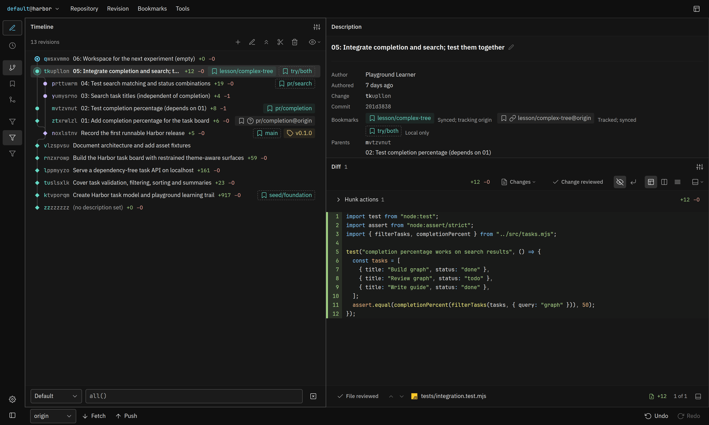
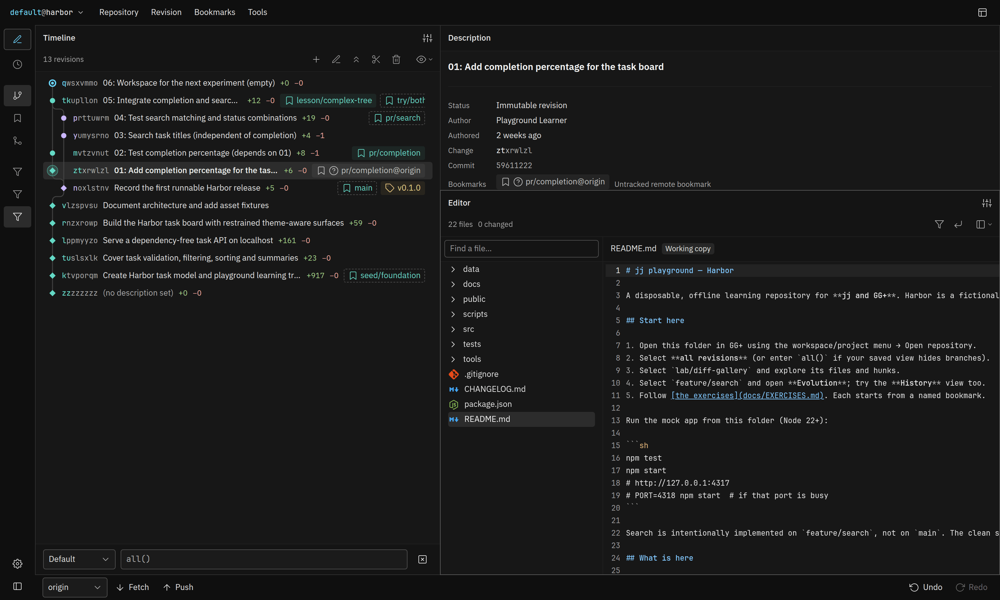

#  GG+

*A hard fork of [GG](https://github.com/gulbanana/gg) by Thomas Castiglione, branched from v0.46.0 in October 2026. It keeps GG's idea, a direct-manipulation GUI for [Jujutsu](https://github.com/jj-vcs/jj), and rebuilds the interface around a dockable workspace, review and notes.*



GG+ shows your repository as a timeline you can work in directly. Drag a revision to rebase it, drag a file to squash or restore it, drag a bookmark to move it, and undo anything from the operation log. Everything around the timeline is a view you can dock where you want it.

## What's in it

- **Dockable views.** Timeline, Description, Diff, Editor, History, Evolution, Annotations, Terminal and Settings split, stack and tab like editor panes, and the layout is remembered.
- **Timeline.** Revisions with their bookmarks, tags and line counts. Click to select, shift-click for a range, double-click to edit. Revset presets live under the timeline.
- **Diff and review.** Unified or side-by-side diffs with syntax highlighting, foldable context and hunk actions. A changed-files browser docks on any side. Mark files and changes reviewed and see what changed since your last look.
- **Editor.** A file tree and a code editor on the working copy, with change markers and notes in the gutter. Saving writes to disk and jj snapshots it.
- **Annotations.** Notes on revisions, bookmarks, files, line ranges and selections. They stay outside the repository, follow code as it moves, and copy out as markdown for a coding agent. `gg annotations` reads and replies from the command line.
- **Menus.** Repository, Revision, Bookmarks and Tools in a menu bar, the app's own context menus everywhere, and a bottom toolbar you configure in Settings.
- **Appearance.** Cold, neutral and warm themes, each with a light level and two dark depths, palettes checked against protanopia, deuteranopia, tritanopia and achromatopsia, and app zoom.
- **Opening folders.** A start page lists recent workspaces. A folder without a repository can be initialized on the spot, colocated with Git by default.



## Installing

GG+ is a Nix flake, built on your own machine. It provides `packages.default` for `x86_64-linux`, `aarch64-linux` and `aarch64-darwin`. Add it to your system's flake:

```nix
# flake.nix
inputs.gg.url = "github:juliuskoskela/gg";
```

Then, in a NixOS or Home Manager module that receives `inputs` (for example through `specialArgs`):

```nix
environment.systemPackages = [ inputs.gg.packages.${pkgs.stdenv.hostPlatform.system}.default ];
# or, with Home Manager
home.packages = [ inputs.gg.packages.${pkgs.stdenv.hostPlatform.system}.default ];
```

Or install it into your profile, or try it without installing:

```sh
nix profile install github:juliuskoskela/gg
nix run github:juliuskoskela/gg -- gui ~/path/to/repository
```

You don't need the jj CLI installed: GG+ embeds Jujutsu. You'll still want it for anything GG+ doesn't cover.

### Running

- `gg` or `gg gui <dir>` opens the desktop app; `gg web <dir>` serves the same interface to your browser.
- Opening a folder that isn't a repository offers to initialize one.
- `gg annotations` lists, shows, exports and replies to notes from the terminal; see `gg annotations --help`.

### Configuration

GG+ reads `jj config`. `revset-aliases.immutable_heads()` matters most: it decides how much history you can edit. GG+'s own settings, with defaults and documentation, are in [`src/config/gg.toml`](src/config/gg.toml), and go in your jj `config.toml`:

```toml
[gg]
default-mode = "gui"

[gg.web]
default-port = 0
```

## Development

Clone the repository, then `nix develop`, `just setup` and `just dev` for the desktop app with hot reload; `just build` makes a release binary in `target/release/gg`. [Development](doc/DEVELOPMENT.md) covers browser iteration, tests and builds; [`AGENTS.md`](AGENTS.md) covers architecture and conventions; [`doc/specs/`](doc/specs) has the specs for surfaces, lines, colour vision and annotations.

## License

Apache 2.0, like upstream. See [LICENSE](LICENSE).
