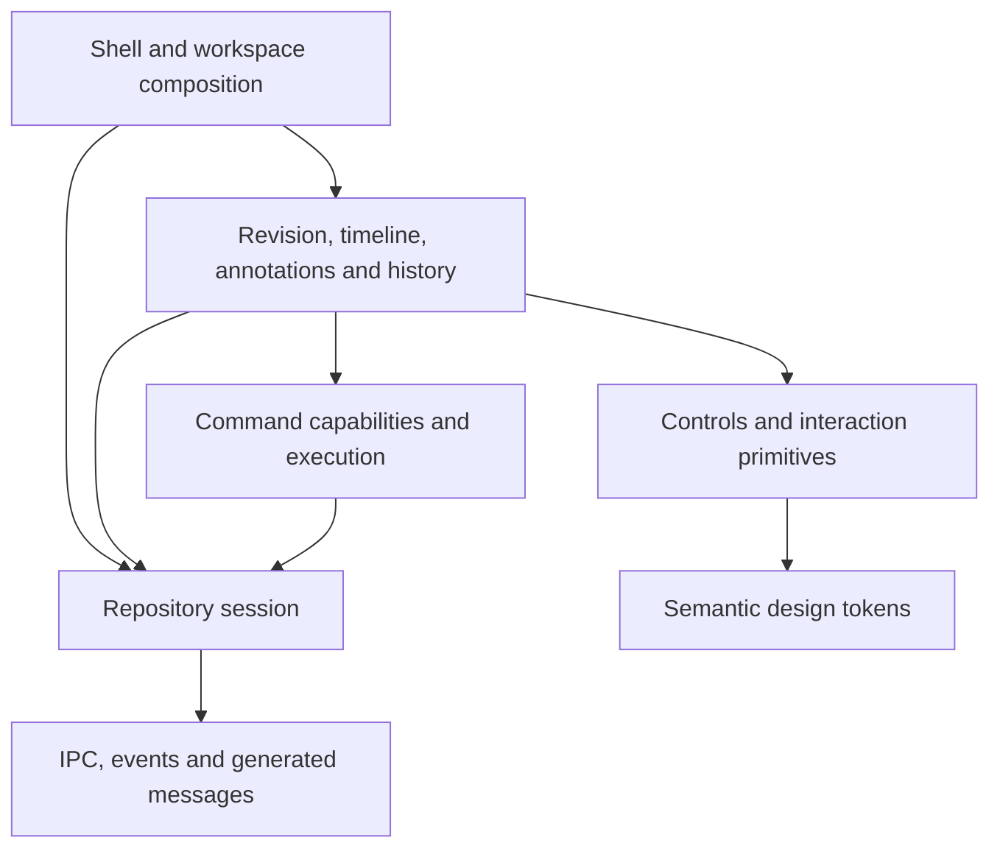

# Frontend architecture and migration plan

Status: proposal for review. Implements the audit in [issue #7](https://git.digimuoto.com/juliuskoskela/gg/issues/7); implementation proceeds through #8–#10 after agreement on these boundaries.

The frontend should remain a small Svelte application with shared interaction primitives, explicit repository ownership and a single transport boundary. A runes migration should preserve behavior before changing structure. It does not require a new state library or replacing every store.

## Current structure

Audited against downstream `main` at `6adc0f5`, with the browser recovery changes in #29. There are 113 Svelte components: 95 use `export let`, 64 have reactive declarations, 70 use legacy event directives, 27 use slots, and four use `createEventDispatcher`. Forty-two TypeScript/Svelte files import `svelte/store`. Components already use Svelte 5 snippets in places while retaining legacy state syntax.

| Area | Responsibility today | Boundary to preserve |
| --- | --- | --- |
| `Shell.svelte`, `App.svelte`, `shell/` | Startup, repository lifecycle, navigation, status and global overlays | Compose services and views; do not implement individual view behavior |
| `workspace/` | Dock tree, panel registry, routing, toolbar ownership and the selected file | Own presentation and navigation independently of domain mutations |
| `revision/` | Summary-first loading, file diffs, metadata, description editing and recovery | Own revision presentation; accept explicit data/selection contracts |
| `LogPane.svelte`, `GraphLog.svelte`, `objects/` | Paginated graph, selection, revision geometry and object rendering | Keep virtualized row identity separate from revision identity |
| `annotations/`, `history/`, `editor/` | Feature-specific state and views | Depend on shared controls and public repository services, not one another's component internals |
| `controls/` | Fields, menus, lists, toolbars, tabs and interaction primitives | Keep rendering primitives reusable; move domain command adapters above them |
| `commands/`, `mutators/`, `operations.ts` | Availability, guarded execution, drag/drop and mutation progress | One capability/command model for menus, palette and direct manipulation |
| `ipc.ts`, `events.ts`, `messages/` | Desktop/web transport, subscriptions and generated wire types | All backend communication crosses this boundary; generated types are not handwritten |
| `display/`, `global.css`, `motion/` | Theme preferences, semantic colors, type roles, density and motion | Components consume semantic tokens; preserve color-vision and contrast checks |

The largest components are LogPane (594 lines), Shell (432), AnnotationsPanel (386), DiffViewer (307), ListWidget (266) and RevisionObject (252). These are review priorities, not automatic split targets: a useful extraction owns behavior with a clear input/output contract.

## What already works

- `revision/data.ts` separates lightweight summary loading from per-file diffs, caches by repository and exact revision identity, and evicts failed requests.
- `commands/registry.ts` shares capability checks and revalidates at execution. A toolbar must not grow an alternative mutation implementation.
- `workspace/dock.ts` has pure tree operations and explicit serialization. Keep this testable without rendering Svelte.
- `ViewToolbar` contributes snippets to the owning panel through context. This is the right seam for changing toolbar placement without copying controls into each view.
- Typography and color-vision palettes already have roles, semantic tokens and numerical tests. They are the design-system foundation.
- The graph's slot-index keys protect virtualization. Replacing them with commit/change keys would be a regression.

## Problems to address

### Repository state has too many owners

`stores.ts` mixes transport-backed events, transient UI state, preferences, revision selection, drafts and caches. `ipc.ts` imports those stores while feature modules import both. Shell coordinates request cancellation, recovery and presentation itself. These dependencies make accidental reinitialization and stale responses hard to see.

Introduce a repository-session service that owns the loaded repository, transport subscriptions, request epochs and cache disposal. Provide it through Svelte context at the workspace root. Retain a narrow store facade during migration. Disposal must invalidate in-flight work before releasing subscribers; loading a new repository cannot retain drafts or cache entries from another repository.

### Shared interactions diverge

ContextMenu implements arrow navigation, type selection, Escape and focus restoration. OptionsMenu and ViewsMenu implement their own opening and dismissal behavior. Share the menu interaction controller and positioning behavior, while allowing context menus, disclosure menus and checkable view choices to render different content. Keep disabled-command explanations in the palette and hide unavailable actions in context menus, as today.

ListWidget, LogList, FileTree and VirtualFileList solve different rendering problems. Share roving focus, visible-option navigation and selection helpers. Do not force a virtual graph, a disclosure tree and history rows into one component. Preserve each widget's accessible role and keyboard model.

ToolbarRow, ViewToolbar and PanelTabs already describe different layers: layout, registration and presentation. Consolidate their ownership contract, not their markup. One panel registers a set of tools; its frame decides where to render them. A standalone view can render the same registration locally.

### Large components mix asynchronous work and presentation

Extract revision selection/rewrite recovery from Shell, selection/keyboard operations from LogPane, annotation draft/thread coordination from AnnotationsPanel, and renderer lifecycle from DiffViewer. Each controller exposes state plus named actions. Components render that state and forward events. Request epochs, disposal and stale-response tests live next to the controller that owns them.

## Target dependency direction

Controls must not import repository stores, mutators, feature views or `ipc.ts`. Feature controllers may import generated message types and session APIs. Leaf renderers do not perform mutations. Cross-feature actions go through commands or workspace navigation, not imported component instances.

## State and runes

| State | Migration choice | Reason |
| --- | --- | --- |
| Props and component-local state | `$props`, `$state`, `$derived` | This is where runes remove the most implicit reactivity |
| Pure derived view data | `$derived` or `$derived.by` | Avoid effects that copy one reactive value into another |
| Component DOM/renderer lifecycle | `$effect` with cleanup, where required | The owner creates and disposes its observer/renderer exactly once per valid input |
| Transport event streams | Keep `Readable`/settable adapters initially | Desktop listeners and SSE are asynchronous resources; store subscriptions already express their lifetime |
| Persistent preferences | Keep typed preference stores initially | Storage events, parsing, defaults and multi-window synchronization are already shared and tested |
| Dock tree and command capabilities | Keep plain TypeScript functions | These are domain algorithms, not reactive rendering state |
| Revision/annotation drafts and view caches | Move into repository-scoped controller factories | Ownership and disposal matter more than syntax |
| Shared component controllers | `.svelte.ts` factories where reactive state helps | Create an instance per owner; expose getters/actions and avoid module-global rune state |

Concretely, keep `repoConfigEvent`, `repoStatusEvent`, `revisionSelectEvent`, `changeSelectEvent` and `progressEvent` behind transport-backed adapters during the mechanical migration. Keep `display/theme.ts`, `display/zoom.ts` and the diff preference stores responsible for persistence and cross-window updates. Move `descriptionDrafts`, `revisionReviewState`, `fileScrollPositions`, `fileHorizontalPositions`, `selectionHeaders` and `pickedRevisions` under the repository-session/selection owners, with compatibility exports until callers migrate. Annotation draft and thread state belongs to an annotation controller scoped to that same session.

Do not destructure reactive controller properties into inert local values. Do not use effects for ordinary derivations. A Svelte store is supported in runes mode; conversion is justified by simpler ownership or APIs, not by a rule banning stores.

## Design-system contract

Use `--font-*` roles for typography and the existing semantic color/spacing/radius/motion tokens. Document every primitive with its role, supported states, keyboard behavior and one usage example. Keep application-specific components out of `controls/` even when more than one feature imports them.

Token lint starts with a recorded baseline and rejects new violations. Allow documented exceptions for third-party diff/terminal rendering and data visualization; never silently exempt a whole feature. Color-vision checks remain independent of screenshot baselines. Keep pointer, keyboard, touch, reduced-motion and forced-color behavior covered.

## Implementation order and gates

1. Land the browser recovery work (#5) and screenshot baselines (#6). Review this audit (#7).
2. Migrate leaf controls by family: icons/chips, fields/toggles, metadata and simple lists. Convert slots to snippets and dispatchers to typed callback props. Commit each independently reviewable family.
3. Migrate panel chrome, menus and nonvirtual feature views. Preserve public behavior; use adapters where a migrated child still has legacy parents.
4. Migrate descriptions, files, history and annotations. Extract controllers only after the mechanical migration for that area passes.
5. Migrate Shell, the virtual graph and DiffViewer separately. Exercise pagination, stale replies, rewritten selections, split/wrapped diffs, renderer teardown and resize behavior.
6. Consolidate shared interaction primitives (#9) and enforce the accepted token rules (#10). Remove transitional facades only after their last consumer has migrated.

For each family: type-check, run its component tests, run affected browser scenarios and compare the relevant screenshot baselines. Full-suite validation gates the completed migration, rather than blocking every mechanical commit. Update baselines only for deliberate visual changes explained in the PR.

## Decisions proposed for agreement

- Preserve transport and preference stores during the initial migration.
- Scope mutable feature controllers to a repository/session and dispose them explicitly.
- Share behavior underneath specialized menus and lists, rather than one universal widget.
- Keep toolbar registration independent of whether controls render above or below content.
- Separate mechanical runes commits from behavior and architectural changes.

This document proposes boundaries; it does not authorize upstream work, rename the project, or merge the review prototype into core.
